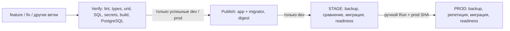

# Архитектура CI/CD StockFlow

## Где работает каждый компонент

| Место | Назначение | Ограничение |
|---|---|---|
| Windows-хост | TeamCity Server в Docker Desktop | Лимит контейнера 2300 МБ; сначала проверить свободную RAM |
| TEST 192.168.56.11 | Один TeamCity Agent, последовательные сборки и отдельная stockflow_ci | Агент 768 МБ; npm-контейнер 2300 МБ; рабочая БД ЛР3 сохраняется |
| STAGE 192.168.56.12 | Приём проверенного DEV-образа | Без сборки Next.js на STAGE |
| PROD 192.168.56.13 | Только сознательное продвижение успешного STAGE | Без автоматического VCS/finish-триггера |
| Docker Hub | Общедоступный учебный репозиторий образов | Платная подписка не требуется; учитывать rate limit |

Перед запуском на Windows: `Get-CimInstance Win32_OperatingSystem | Select-Object FreePhysicalMemory,TotalVisibleMemorySize`.
На TEST: `free -h`, `df -h /`, `docker stats --no-stream`. Общий бюджет сборки близок
к 4 ГБ; лимит агента НЕ ограничивает контейнеры, запущенные через docker.sock.
Сборки последовательны. При OOM выполнять сборки агентом на Windows-хосте в Linux
Docker, оставив агент TEST подключённым для демонстрации доставки; предварительно
изменить agent requirement в DSL. Не обещаем, что одна VM выдержит всё одновременно.
Не запускать параллельные TeamCity-конфигурации: один агент выполняет одну сборку.
При нехватке памяти остановить только лишние локальные процессы/сборки, не PostgreSQL.

## Цепочка и границы доверия

ЛР4 начинает с двух конфигураций. ЛР5 добавляет STAGE. ЛР6 добавляет Gitleaks
к существующему ESLint. ЛР7 добавляет изолированный acceptance-контур. ЛР8
добавляет сравнение схем и backup. Контрольные ветки перечислены в IMPLEMENTATION_STATUS.
Не переносить HEAD финальной ветки в dev при выполнении ЛР4.

Kotlin DSL — классические Build Configuration TeamCity 2026.2. Они понятнее для
этого задания, чем новая отдельная модель Pipelines. API и версия контейнеров
согласованы; `.teamcity/pom.xml` позволяет генерировать XML и проверять DSL.
Настройки проекта читать из доверенной ветки, а не из ветки запускаемой сборки.
Для ранних работ используйте соответствующую контрольную ветку настроек.

Verify имеет VCS-триггер для всех веток. Publish имеет finish-триггер успешного
Verify только dev/prod и snapshot dependency того же исходного состояния.
STAGE зависит от Publish того же состояния и получает артефакт через `sameChain()`.
PROD зависит от STAGE; обычного триггера нет. Все snapshot-зависимости запрещают
продолжение при ошибке/отмене. Для ручного продвижения используйте Promote
конкретной успешной сборки STAGE, а не произвольный последний номер.

Build agent использует checkout на агенте (Git metadata нужны для rev-parse).
Рекомендуется очищать checkout между сборками: нельзя наследовать `.env`,
`incoming` и артефакты предыдущей ветки. Проверяемый git SHA должен совпадать
с RELEASE_SHA. Для PROD дополнительно проверяется удалённая refs/heads/prod.

## Образы и секреты

Publish собирает runner и migrator с одним полным SHA. Теги `dev-<40 символов SHA>`
и `prod-<SHA>`, у migrator суффикс `-migrator`. После push/pull записываются
`repo@sha256:...` — именно эти ссылки развёртываются. На PROD переносится тот же
DEV-артефакт успешного STAGE; отдельная публикация prod нужна для требования ЛР4,
но не является поводом повторно собирать уже проверенную версию для PROD.

DOCKERHUB_TOKEN — Password-параметр только Publish. Не задавать его в родительском
проекте. Проект публичный: для GitHub checkout PAT не требуется. Для приватного
репозитория нужен read-only deploy key/PAT в VCS Root, без передачи приложению.
SSH-ключ — локальный файл TEST; в Git только ssh_config.example. Сверить fingerprint
STAGE/PROD по консоли VirtualBox, затем записать known_hosts. Не применять
StrictHostKeyChecking=no. Server доступен агенту через обратный SSH-туннель.

Агент с docker.sock эквивалентен root на TEST: даже Verify без секретных параметров
может читать файлы TEST. Поэтому не подключать fork PR и недоверенных авторов,
не запускать произвольный код из Интернета. Это персональный доверенный учебный
репозиторий. Защита веток/реальный reviewer важны; маскирование пароля в журнале
не защищает от злонамеренного кода. PROD SSH-доступ выдавать лишь перед ЛР8;
пользователю с ролью Viewer не давать Run PROD/Edit configuration.

## Данные и схема

`compose.yaml` ЛР3 сохранён. `compose.release.yaml` сбрасывает build и автоматическую
зависимость app от migrate, использует тот же PROJECT и тот же каталог `.env`.
Обновляется `app --no-deps`; db не пересоздаётся. Скрипт проверяет фактический том
через docker inspect и EXPECTED_DB_VOLUME. Совпадение названия каталога недостаточно.

В ЛР8 эталон TEST получается из одноразовой БД успешной сборки на TEST-сервере.
Это отдельный CI-контур TEST, а не заранее обновлённая действующая БД ЛР3.
STAGE до миграции может отставать: сначала сравниваются история и схемы, затем
его backup восстанавливается во временную БД, мигрируется тем же образом и
сравнивается с TEST. Только совпадение разрешает настоящую миграцию STAGE.
После неё схема и hash-история снова сравниваются. Для PROD эталон экспортируется
уже с реально обновлённого STAGE, не подменяется локальным описанием Drizzle.

Backup — custom pg_dump, pg_restore --list, фактическое восстановление во временную
БД и сравнение содержимого таблиц. Backup хранится вне репозитория. Работать в окне
без пользовательских записей: иначе контрольный hash может измениться. На небольшом
стенде репетиция и проверка backup временно требуют места на несколько копий БД.

Вне объёма: высокая доступность, TLS reverse proxy, коммерческий production,
автоматический rollback произвольных несовместимых схем. Добавочные nullable-поля
позволяют вернуть прежний образ приложения без удаления данных.

## Первичные источники

- [Kotlin DSL TeamCity 2026.2](https://www.jetbrains.com/help/teamcity/2026.2/kotlin-dsl.html).
- [Строгая зависимость sameChain](https://teamcity.jetbrains.com/app/dsl-documentation/root/artifact-dependency/index.html).
- [Официальный Docker Agent и одинаковые bind paths](https://github.com/JetBrains/teamcity-docker-images/blob/master/dockerhub/teamcity-agent/README.md).
- [Gitleaks](https://github.com/gitleaks/gitleaks).
- [Squawk CLI](https://squawkhq.com/docs/cli/).
