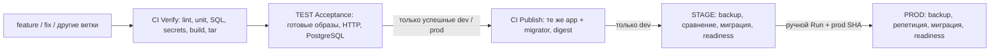

# Архитектура CI/CD StockFlow на Linux

## Выбранное размещение

| Узел | Роль | Ресурсы/состояние |
|---|---|---|
| Новая CI Linux VM | TeamCity Server + stockflow-build-agent + BuildKit | Предлагается4vCPU/8ГБ/60ГБ; пока не создана, IP192.168.56.14 проверить |
| TEST192.168.56.11 | stockflow-test-agent: Acceptance и SSH-доставка |4ГБ; рабочие app/db сохраняются; никаких тяжёлых сборок |
| STAGE192.168.56.12 | Приём digest, проверка схемы |4ГБ; исходный volume и собственные данные |
| PROD192.168.56.13 | Только ручное продвижение STAGE |4ГБ; backup/rehearsal перед миграцией |
| Windows | PowerShell, SSH, Git, браузер, скриншоты | Docker Desktop не требуется |
| Домашний Ryzen/64ГБ | Альтернативный CI Linux | Только после проверки Linux/Docker/диска и частного маршрута к TEST |

Существующие4ГБ VM не подходят для Server+Next build+рабочей PostgreSQL одновременно.
Размещение только Server на STAGE/PROD также добавляет риск учебным данным. Новая VM
изолирует CI и не требует маршрутизации в другую физическую сеть. На ноутбуке должно
хватать RAM для самой VM: проверить до её создания, при необходимости штатно завершить
неиспользуемую PROD до ЛР8. Если8ГБ выделить нельзя, выбрать домашний сервер ПОСЛЕ
проверок из LINUX_CI_SETUP_RU, а не запускать сборки на TEST наугад.

Server ограничен2300МБ, build-agent768МБ, BuildKit3ГБ. Контейнер npm2300МБ завершается
до сборки BuildKit. TEST acceptance: db384МБ, app512МБ, tools512МБ, migrator256МБ;
агент768МБ отдельно, tmpfs256МБ входит в потребление db. Preflight проверяет MemAvailable
и свободный диск, останавливает задачу при недостатке; не гарантирует успех при
параллельной посторонней нагрузке. Один build-agent и один TEST-agent, без дубликатов.
TEST никогда не выполняет npm ci/Next build/docker build. Root socket обоих агентов
даёт root на соответствующем хосте; это доверенный личный репозиторий, без fork PR.

[Полная настройка Linux, сеть, адреса и resource gates](LINUX_CI_SETUP_RU.md).

## Цепочка и границы доверия

ЛР4 начинает с двух конфигураций. ЛР5 добавляет STAGE. ЛР6 добавляет Gitleaks
к существующему ESLint. ЛР7 добавляет изолированный acceptance-контур. ЛР8
добавляет сравнение схем и backup. Контрольные ветки перечислены в IMPLEMENTATION_STATUS.
Не переносить HEAD финальной ветки в dev при выполнении ЛР4.

Kotlin DSL — классические Build Configuration TeamCity 2026.2. Они понятнее для
этого задания, чем новая отдельная модель Pipelines. API и версия контейнеров
согласованы; `.teamcity/pom.xml` позволяет генерировать XML и проверять DSL.
Настройки проекта читать из доверенной ветки, а не из ветки запускаемой сборки.
Для ранних работ используйте соответствующую контрольную ветку настроек.

Verify имеет VCS-триггер всех веток на build-agent CI. С ЛР7 Acceptance имеет
finish-триггер Verify всех веток и snapshot dependency; выполняется TEST-agent.
Publish с ЛР7 зависит от Acceptance (раньше — Verify), только dev/prod.
STAGE зависит от Publish того же состояния и получает артефакт через `sameChain()`.
PROD зависит от STAGE; обычного триггера нет. Все snapshot-зависимости запрещают
продолжение при ошибке/отмене. Для ручного продвижения используйте Promote
конкретной успешной сборки STAGE, а не произвольный последний номер.

Build agent использует checkout на агенте (Git metadata нужны для rev-parse).
Рекомендуется очищать checkout между сборками: нельзя наследовать `.env`,
`incoming` и артефакты предыдущей ветки. Проверяемый git SHA должен совпадать
с RELEASE_SHA. Для PROD дополнительно проверяется удалённая refs/heads/prod.

## Образы и секреты

Verify на CI собирает runner/migrator, с ЛР7 test-tools; сохраняет docker save+gzip
и sha256 в artifacts. TEST загружает архив той же sameChain, сверяет checksum и
revision labels; запускает без --build. При ошибке Acceptance Publish запрещён.
Publish на CI загружает тот же архив, только добавляет Hub-теги, push/pull и digest.
Теги dev-<полныйSHA>/prod-<полныйSHA>, migrator с суффиксом-migrator.
Feature/FIX проходят все проверки, но их образы в Hub не публикуются. PROD получает
те же digest успешного STAGE; его конфигурация не имеет автоматического триггера.
Артефакты не должны подменяться последним успешным билдом другой ветки: sameChain strict.

DOCKERHUB_TOKEN — Password-параметр только Publish. Не задавать его в родительском
проекте. Проект публичный: для GitHub checkout PAT не требуется. Для приватного
репозитория нужен read-only deploy key/PAT в VCS Root, без передачи приложению.
SSH-ключ — локальный файл TEST; в Git только ssh_config.example. Сверить fingerprint
STAGE/PROD по консоли VirtualBox, затем записать known_hosts. Не применять
StrictHostKeyChecking=no. Server доступен обоим агентам по private TEAMCITY_SERVER_URL, например
http://192.168.56.14:8111. localhost внутри агента не является Server. Windows-туннель
не участвует в работе CI. Для домашнего сервера используется проверенный private VPN/LAN.

Агент с docker.sock эквивалентен root на своём Linux-хосте: даже Verify без секретных параметров
может читать файлы TEST. Поэтому не подключать fork PR и недоверенных авторов,
не запускать произвольный код из Интернета. Это персональный доверенный учебный
репозиторий. Защита веток/реальный reviewer важны; маскирование пароля в журнале
не защищает от злонамеренного кода. PROD SSH-доступ выдавать лишь перед ЛР8;
пользователю с ролью Viewer не давать Run PROD/Edit configuration.

## Данные и схема

`compose.yaml` ЛР3 сохранён. `compose.release.yaml` сбрасывает build и автоматическую
зависимость app от migrate, использует тот же PROJECT и тот же каталог `.env`.
Обновляется `app --no-deps`; db не пересоздаётся. Скрипт проверяет фактический том
через docker inspect и EXPECTED_DB_VOLUME. Совпадение названия каталога недостаточно.

В ЛР8 эталон TEST получается из одноразовой БД успешной сборки на TEST-сервере.
Это отдельный CI-контур TEST, а не заранее обновлённая действующая БД ЛР3.
STAGE до миграции может отставать: сначала сравниваются история и схемы, затем
его backup восстанавливается во временную БД, мигрируется тем же образом и
сравнивается с TEST. Только совпадение разрешает настоящую миграцию STAGE.
После неё схема и hash-история снова сравниваются. Для PROD эталон экспортируется
уже с реально обновлённого STAGE, не подменяется локальным описанием Drizzle.

Backup — custom pg_dump, pg_restore --list, фактическое восстановление во временную
БД и сравнение содержимого таблиц. Backup хранится вне репозитория. Работать в окне
без пользовательских записей: иначе контрольный hash может измениться. На небольшом
стенде репетиция и проверка backup временно требуют места на несколько копий БД.

Вне объёма: высокая доступность, TLS reverse proxy, коммерческий production,
автоматический rollback произвольных несовместимых схем. Добавочные nullable-поля
позволяют вернуть прежний образ приложения без удаления данных.

## Первичные источники

- [Kotlin DSL TeamCity 2026.2](https://www.jetbrains.com/help/teamcity/2026.2/kotlin-dsl.html).
- [Строгая зависимость sameChain](https://teamcity.jetbrains.com/app/dsl-documentation/root/artifact-dependency/index.html).
- [Официальный Docker Agent и одинаковые bind paths](https://github.com/JetBrains/teamcity-docker-images/blob/master/dockerhub/teamcity-agent/README.md).
- [Gitleaks](https://github.com/gitleaks/gitleaks).
- [Squawk CLI](https://squawkhq.com/docs/cli/).

Ресурсные и сетевые решения сверены с первичными источниками:
[TeamCity system requirements](https://www.jetbrains.com/help/teamcity/system-requirements.html),
[зависимости артефактов](https://www.jetbrains.com/help/teamcity/artifact-dependencies.html),
[лимит памяти Docker BuildKit](https://docs.docker.com/build/builders/drivers/docker-container/).
Это обоснование конфигурации, не доказательство реального запуска на VM.
